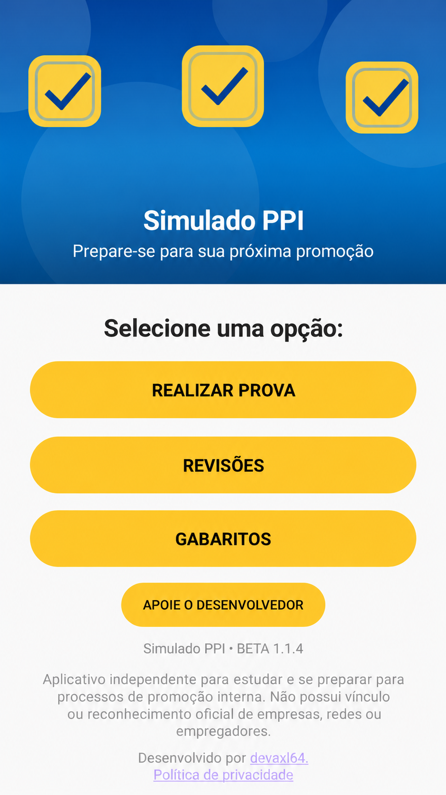
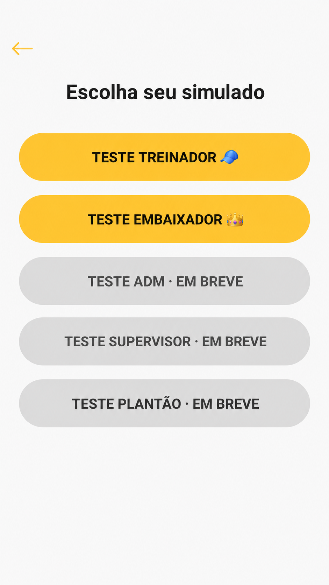
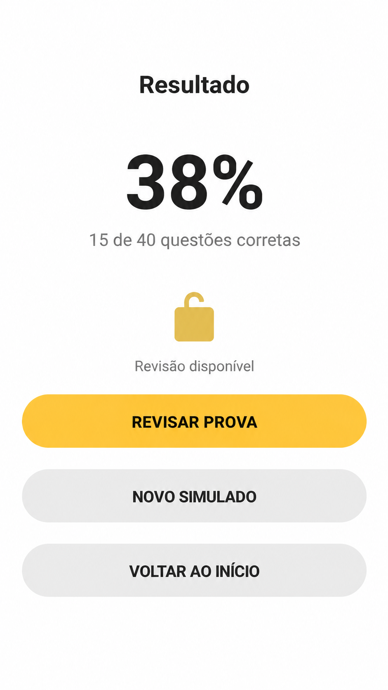
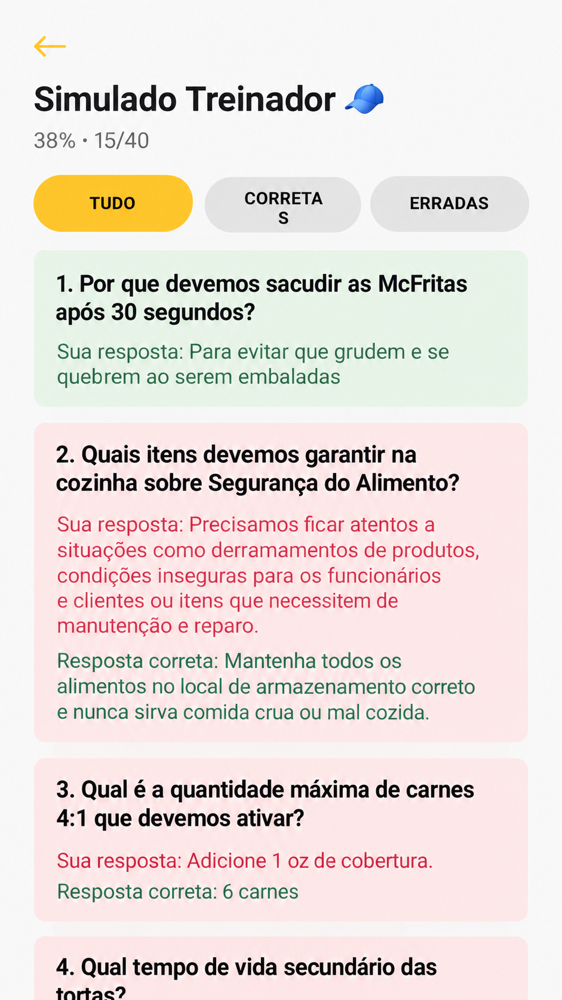

# Simulado PPI

**Prepare-se para sua próxima promoção.**

O **Simulado PPI** é um aplicativo Android educacional e independente, criado para apoiar o estudo de profissionais que se preparam para avaliações e processos de promoção interna.

O aplicativo reúne simulados de múltipla escolha, correção automática e ferramentas para acompanhar o aprendizado — com uma experiência simples, organizada e voltada para dispositivos Android.

> **Aviso:** projeto independente, sem vínculo, patrocínio ou aprovação oficial de empresas ou redes de restaurantes.

## Funcionalidades

- Simulados de **Treinador** e **Embaixador** disponíveis gratuitamente na beta.
- Questões sorteadas de bancos locais e organizadas em páginas.
- Correção automática e visualização do desempenho.
- Revisão de respostas após a conclusão de uma prova.
- Histórico local de resultados.
- Consulta aos gabaritos disponíveis no aplicativo.
- Funcionamento sem cadastro obrigatório.

**Em preparação:** conteúdos para Auxiliar Administrativo, Supervisor e Gerente de Plantão. Possíveis recursos pagos e anúncios são planos futuros, não funcionalidades disponíveis na beta atual.

## Capturas de tela

As imagens abaixo devem ser capturas **reais da versão atual**, sem referências visuais à identidade de terceiros. Os arquivos deverão ser adicionados à pasta `Prints/` antes da divulgação pública deste README.

| Início | Seleção de simulados | Prova |
|:---:|:---:|:---:|
|  |  |  |

| Resultado | Revisão |
|:---:|:---:|
|  |  |

## Tecnologias

- Java
- Android SDK
- XML para interfaces
- Android Studio e Gradle
- Git e GitHub

O código-fonte é mantido em um **repositório privado**. Este repositório público destina-se à apresentação do projeto e à documentação acessível aos usuários.

## Desenvolvimento com apoio de IA

O projeto contou com apoio de ferramentas de inteligência artificial para implementação e revisão de código. A concepção, escolha de funcionalidades, regras, organização do conteúdo, decisões de interface e testes fazem parte do trabalho de desenvolvimento conduzido pelo autor.

## Status do projeto

**Beta em preparação para testes pela Google Play.** A versão de desenvolvimento mais recente registrada é a **1.1.6**, sujeita à validação final. Ainda não há um link público de instalação aprovado.

> Este repositório não oferece APK para download. Quando a distribuição oficial estiver disponível, o link será incluído aqui.

## Política de privacidade e contato

- **Política de privacidade:** disponível em `privacy/index.html` neste repositório, após a publicação da página.
- **Contato:** [axl3764@gmail.com](mailto:axl3764@gmail.com)

## Desenvolvedor

Projeto desenvolvido por **devaxl64** como parte do portfólio de desenvolvimento Android.

[GitHub — devaxl64](https://github.com/devaxl64)
